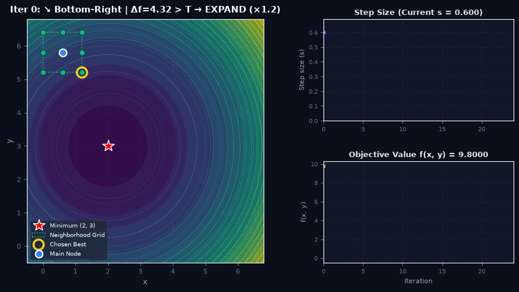

# Proposing Novel Optimization Algorithm : Incremental Grid Search Optimization (IGSO)

## ABOUT

The IGSO concept is heavily-inspired by **neighborhood search methods** as part of metaheuristic optimization techniques, particularly methods that **can find local optimums for non-differentiable continuous functions**. A feature of IGSO is it allows manual alterations to encourage little/big solution exploration via a user-set threshold $T$.

 > Want to try it out? Click the [`INTERACTIVE SIMULATION`](https://sashasgithome.github.io/jump-n-search/). 

## PROPOSED ALGORITHM 

Starting with a _main node_, values of $f(x)$ are found for every new node located within a distance (stepsize) $s$ away, and the new node with lowest $f(x)$ value becomes the next _main node_. Depending on the "distance" between lowest $f(x)$ and the _main node_, the stepsize $s$ will increase or decrease in the next iteration.

#### Functions & Formulation

1. **Neighbor Generation**:  
   Around current main node $\mathbf{x}_0 = (x_0, y_0)$, generate $n = 3^d - 1$ candidate neighbors at distance $s$ (step size):
   - $(nx_1, ny_1) = (x_0 - s, y_0 - s)$
   - $(nx_2, ny_2) = (x_0 + s, y_0 - s)$
   - $(nx_3, ny_3) = (x_0 - s, y_0 + s)$
   - $(nx_4, ny_4) = (x_0 + s, y_0 + s)$ ... and continued for all coordinate combinations.

2. **Greedy Node Selection**:  
   Between all neighbors and the main node itself, select the candidate with the lowest function value: $\mathbf{x}_{\text{next}} = \arg\min f(\mathbf{p})$.

3. **Step Size Update Function**:  
   Compute improvement $\Delta f = |f(\mathbf{x}) - f(\mathbf{x}_{\text{next}})|$ and adapt step size for the next iteration:
   - If $\Delta f > T$: $s_{\text{next}} = \min(s \times 1.2, \ s_{\max})$ *(encourage exploration)*
   - If $\Delta f \le T$: $s_{\text{next}} = \max(s \times 0.8, \ s_{\min})$ *(encourage exploitation)*  
   *(The scaling factors 1.2 and 0.8 can be adjusted manually).*

4. **Stopping Criteria**:  
   The search terminates when $s \le s_{\min}$ for consecutive iterations (no further improvement).

#### Known Limitations

- **Curse of Dimensionality ($O(3^d)$ Complexity)**: Candidate generation scales exponentially as $n = 3^d - 1$ where $d$ is the number of input variables. While a 1D function evaluates only 2 neighbors and a 2D function evaluates 8 neighbors, higher-dimensional functions scale rapidly (e.g. 26 neighbors in 3D, and 80 neighbors for 4 variables $w, x, y, z$). This exponential growth makes high-dimensional evaluations computationally demanding.
- **Local Optima Entrapment**: Like Gradient Descent, greedy candidate selection can become trapped in deceptive local basins without random restarts.
- **Hyperparameter Sensitivity**: Search speed and precision depend on appropriate initial choices for $s$, $T$, $s_{\min}$, and $s_{\max}$.

To understand more on its inner workings, see `documentation/method-report.pdf`.

## COMPARISON WITH EXISTING METHODS

IGSO shares concepts with Derivative-Free Optimization (DFO) and pattern search heuristics.

| Method | Candidate Geometry | Step Adaptation Mechanism | Non-Differentiable? | Discontinuous? |
| :--- | :--- | :--- | :---: | :---: |
| **IGSO (Proposed)** | Full $3^d - 1$ hypercube grid | Quantitative improvement $\Delta f$ vs threshold $T$ ($\times 1.2$ / $\times 0.8$) | Yes | Yes (local) |
| Hooke-Jeeves | $2d$ orthogonal coordinate axes | Step size shrinks on failed exploration | Yes | Moderate |
| Nelder-Mead | $(d + 1)$ geometric simplex | Geometric reflect, expand, contract, shrink | Yes | Moderate |
| Simulated Annealing | Stochastic random sample | Temperature cooling schedule | Yes | Yes |

**How IGSO stands out:**
- **Full hypercube neighborhood**: Evaluates both axial and diagonal coordinate combinations simultaneously ($3^d - 1$ points) around the main node.
- **Drop-sensitive adaptation**: Grid size expands or contracts based on whether the magnitude of improvement $\Delta f$ exceeds threshold $T$, rather than strictly on directional pass/fail.

## Authors

| Author Name | Contribution |
| :--- | :--- |
| Sasha Annabel | research, code, prototyping, documentation |
| Kreshnayogi Dava Berliansyach | research, formulation, code, validation testing |
